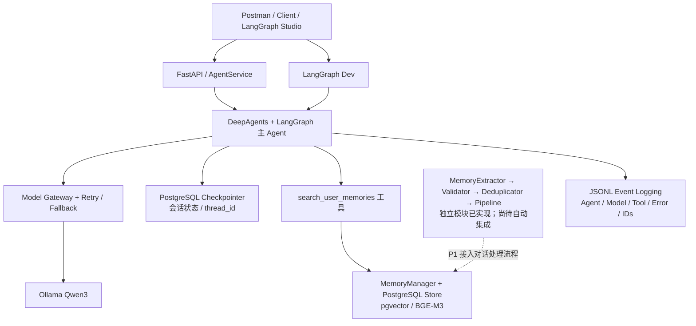

# Hermes Local Workbench (HLW)

> **Local-first · Persistent memory · Modular agents · Observable execution**  
> 基于本地模型、长期记忆、工具扩展与可追踪执行的模块化 AI Agent 工作台。

**Repository:** [zdx1216/HLW](https://github.com/zdx1216/HLW)  
**Version:** `0.1.0-dev`（开发版本）  
**Current milestone:** **P0 核心工程与日志基础完成 → P1 长期记忆集成**  
**Status date:** 2026-11-07  
**Primary environment:** Windows · Python 3.11 · uv · Ollama · PostgreSQL · DeepAgents / LangGraph

> **状态说明**：本文依据 GitHub `main` 分支提交 `7033f38` 的源码，以及 2026-11-07 的本地验收记录编写。最新本地记录为 **205 passed**、`ruff check .` 通过；这不是 GitHub CI 的实时测试结论。文中严格区分“已有代码”“已验证”“下一阶段计划”。

## 1. 项目目标

HLW（Hermes Local Workbench）旨在逐步构建一个**本地优先、长期运行、可扩展、可追溯、可控制**的个人 AI Agent 工作平台。它不仅回答问题，还将逐步具备跨会话记忆、工具使用、文档知识检索、任务规划和多 Agent 协作能力。

设计目标：

1. **Local-first**：优先使用 Ollama 本地模型以及本地 PostgreSQL 保存数据。
2. **Persistent memory**：同时支持会话状态（Checkpoint）和跨会话长期记忆（Store），两者不能混淆。
3. **Modular architecture**：Agent、模型网关、记忆、工具、API、日志分别管理，尽量避免耦合。
4. **Resilience**：模型超时、连接失败、重试和备用模型回退具备明确处理路径。
5. **Observability**：记录用户请求、模型输入输出、工具执行、异常、耗时及追踪 ID。
6. **Controlled execution**：敏感信息、记忆冲突、外部写入及高风险操作遵循授权与隔离原则。
7. **Extensibility**：未来逐步接入 Skills、MCP、RAG、Multi-Agent 和 Web UI。

**当前阶段边界**：全链路日志 V1.0 视为已完成的基础设施；当前工作重点转向 **P1 长期记忆集成**。本阶段**不开发模型评分、自动回答质量评估或自动裁判系统**。

## 2. 当前架构



- **短期对话状态**：由 LangGraph Checkpointer 使用 `thread_id` 持久化，支持会话延续。
- **长期用户记忆**：由 `MemoryManager` 使用 `("users", user_id, "memories")` 命名空间管理，存储在 PostgreSQL Store 中；通过向量检索跨会话复用。
- **已有记忆读取入口**：`search_user_memories` 已注册到主 Agent，但调用依赖可信 `user_id`、已配置的 Store 和模型的工具选择；**不等同于每轮自动检索和注入**。
- **已有记忆写入处理链**：Extractor、Validator、Deduplicator 和 Pipeline 均已有独立实现；**尚未自动挂接到正常 Agent 请求生命周期**。
- **日志**：API 与 Dev 复用事件结构，但分别写入不同目录。

## 3. 当前进度（截至 2026-11-07）

| 模块                                      | 状态                     | 已实现 / 已验证范围                                          |
| ----------------------------------------- | ------------------------ | ------------------------------------------------------------ |
| 工程与依赖管理                            | **已实现**               | `src/hlw`、`pyproject.toml`、`uv.lock`、环境配置             |
| DeepAgents / LangGraph 主图               | **已实现**               | 统一 Graph 工厂、普通/持久化模式、工具注册                   |
| AgentService                              | **已实现并测试**         | 异步执行、单用户身份、请求上下文、并发限制、同线程进程内锁   |
| 模型网关                                  | **已实现并测试**         | Ollama OpenAI 兼容接口、主备模型、超时配置、流式 Token 用量配置 |
| 模型可靠性                                | **已实现并测试**         | 错误分类、有限重试、退避、备用模型回退                       |
| PostgreSQL Checkpointer                   | **已实现并做过集成验证** | 会话状态持久化与恢复                                         |
| PostgreSQL Store / pgvector               | **已实现并做过集成验证** | 长期记忆存储、BGE-M3 Embedding、自然语言语义检索             |
| MemoryManager                             | **已实现并测试**         | 用户命名空间、CRUD、分类检索、分页和语义检索                 |
| MemoryExtractor / Validator               | **已实现并测试**         | 结构化候选记忆、原文证据和部分敏感凭证规则                   |
| MemoryDeduplicator / Pipeline             | **已实现并测试**         | 重复、冲突、授权更新及执行锁；当前主要作为独立组件运行       |
| Agent 记忆检索工具                        | **已接入主图**           | `search_user_memories`；仍需跨线程与 Dev/API 端到端验收      |
| API / LangGraph Dev                       | **已实现并验证**         | `/health`、`/chat`、Studio 调试、持久化组件接入              |
| 结构化日志 V1.0                           | **本阶段完成**           | Agent / Model / Tool、异常、重试、回退、关联 ID、Token、双模式 JSONL |
| Docker Compose                            | **已实现**               | PostgreSQL + API 编排、数据持久化、健康检查；生产强化尚未完成 |
| 自动长期记忆闭环                          | **P1 待完成**            | 自动提取、写入策略、跨会话自动检索、冲突确认及故障降级       |
| Skills / MCP / RAG / Multi-Agent / Web UI | **规划中**               | 尚未形成完整产品能力                                         |

### 3.1 日志系统 V1.0：已完成的范围

**主要事件**：

- `agent.run.started` / `agent.run.completed`：用户输入、最终回答、Agent 总耗时。
- `model.request` / `model.response`：模型请求、响应消息和可用的 Token 数据。
- `model.attempt.started` / `model.attempt.completed` / `model.attempt.failed`：每次模型尝试。
- `model.call.summary`：主备模型、重试次数、回退使用情况和总耗时。
- `tool.call.started` / `tool.call.completed` / `tool.call.failed`：工具参数、返回值和异常。
- 取消、控制流等特殊情况保留相应事件或传播行为。

**追踪字段**：

| 字段                         | 语义                                  |
| ---------------------------- | ------------------------------------- |
| `user_id`                    | 用户身份；当前是配置驱动的单用户模式  |
| `thread_id`                  | 会话 ID，供 Checkpointer 恢复历史状态 |
| `request_id`                 | 单次业务请求的关联标识                |
| `run_id`                     | 单次 Agent / Graph 根执行 ID          |
| `trace_id`                   | 同一次请求的整条追踪链                |
| `span_id` / `parent_span_id` | 模型尝试、工具执行等子步骤的关联      |

**日志路径**：

```text
logs/api/hlw.log
logs/api/events.jsonl
logs/langgraph_dev/hlw.log
logs/langgraph_dev/events.jsonl
```

**已记录的验证结果**：

- `uv run ruff check .`：通过。
- `uv run pytest -q`：**205 passed**（本地运行记录）。
- Postman API 真实请求：14/14 条事件有 Run ID，且仅有 1 个根 Run ID。
- LangGraph Dev 真实请求：14/14 条事件有 Run ID，且仅有 1 个根 Run ID。
- 工具输入和输出字段、Agent 输入和输出字段、模型请求响应已检查存在。
- Dev 流式模型响应已记录实际 Token 用量。
- 模拟 JSONL 集成测试：**重试成功、回退成功、主备全部失败**三类场景均通过。

> 以上表示本阶段日志功能验收达标，不意味着在任意生产故障下日志都绝不丢失。日志会记录对话原文，已有脱敏只覆盖部分常见凭证格式，生产部署前仍需完善访问控制、保留周期和敏感数据治理。日志不是自动评分系统。

## 4. 下一阶段：P1 长期记忆集成（当前重点）

### 4.1 P1 的目标

让同一用户在**不同 `thread_id`、不同时间的对话**中，能够可靠地保存、检索、使用、更新和删除长期记忆，并确保历史记忆只是参考数据而非可执行指令。

**最终使用示例**：

- 会话 A：用户明确表达“以后技术学习优先采用目的 → 代码路径 → 原理 → 小测的方式”。
- 系统根据保存策略提取候选、验证证据、保存到该用户的长期记忆。
- 会话 B（新 `thread_id`）：用户询问“继续上次的开发课程”。Agent 能检索这条偏好，并在适当条件下用作回答上下文。
- 用户提出新偏好与旧记忆冲突时，系统不擅自覆盖，必须获得明确确认。

### 4.2 已有基础与尚缺环节

**可以直接复用**：

- `MemoryManager`：保存、读取、修改、删除、列表及语义检索。
- `MemoryExtractor`：通过模型提取候选记忆，类别为 `preference` / `project` / `workflow` / `fact`。
- `MemoryValidator`：原文证据校验、重复 key 检测和部分凭证过滤。
- `MemoryDeduplicator`：新建、重复、冲突与明确授权更新。
- `MemoryPipeline`：串联 Extractor → Validator → Deduplicator。
- `open_postgres_store()`：PostgreSQL + pgvector + Ollama BGE-M3。
- `search_user_memories`：已经注册到 Agent 的检索工具。
- 单用户 `user_id`、持久化 Runtime、JSONL 关联日志和已有单元/集成测试。

**需要完成**：

- 将 Pipeline 安全地连接到对话流程，并明确何时可以自动写入新记忆。
- 在用户需要历史信息时，稳定检索并注入相关记忆；区分“模型自选调用工具”和“请求前自动注入”策略。
- 建立冲突待确认状态及确认/拒绝流程，不能信任客户端随意提交的记忆对象。
- 验证 API 和 LangGraph Dev 中的 `user_id` 传递及真实 Store 注入。
- 实现跨 Thread、服务重启、无结果、Store 断连、并发和重复写入的端到端验收。
- 记录记忆检索、候选提取、拒绝、保存、冲突、确认和删除等事件，但不得将秘密明文输出到日志。

### 4.3 建议实施顺序（小步开发）

| 子阶段              | 目标                                                   | 验收标准                                                     |
| ------------------- | ------------------------------------------------------ | ------------------------------------------------------------ |
| **P1.1 现状基线**   | 核查 Store、MemoryManager、检索工具和真实身份上下文    | 同一用户 API/Dev 正确读取测试记忆；不同 `thread_id` 能访问同一用户命名空间 |
| **P1.2 检索闭环**   | 确定工具触发策略与记忆上下文注入边界                   | 新会话可正确使用相关记忆，空结果不编造历史事实               |
| **P1.3 写入闭环**   | 把 Pipeline 与请求完成流程集成，明确新记忆写入授权策略 | 从真实消息生成候选、校验、去重、保存；一次性内容不误入长期记忆 |
| **P1.4 冲突确认**   | 为更新冲突提供可信的待确认记录和用户操作接口           | 未确认不覆盖；确认仅作用于指定候选；并发/重复确认安全        |
| **P1.5 异常与审计** | 隔离 Store/Embedding/Extractor 故障，补充记忆事件日志  | 记忆异常不污染主 Agent；日志可用 Request ID / Run ID 追踪    |
| **P1.6 端到端验收** | 跨会话、重启、删除、隔离及故障恢复测试                 | Ruff 与 Pytest 通过，Postman 和 Studio 真实验证，文档同步    |

> **实施边界**：当前为单用户模式，暂不将“多用户登录/完整鉴权系统”混入 P1 第一轮，但不得把客户端任意提供的 `user_id` 当作可信身份。需要多用户时，再补认证、会话所有权与用户隔离控制。

### 4.4 P1 完成的定义（Definition of Done）

- [ ] 用户的新会话能够获取已保存且相关的长期记忆。
- [ ] 不同 `thread_id` 共享同一 `user_id` 的长期记忆，但不混淆对话 Checkpoint。
- [ ] 无相关记忆时明确返回空结果，不杜撰历史。
- [ ] 候选记忆有原文证据、敏感信息过滤和明确保存规则。
- [ ] 重复记忆不重复保存；冲突记忆在确认之前不覆盖。
- [ ] 用户能查看、更新与删除自己的记忆。
- [ ] PostgreSQL / Ollama / Embedding 异常时行为可控，并保留诊断事件。
- [ ] API、Dev、PostgreSQL 实际联调通过；单元和集成测试通过。
- [ ] 更新 `README.md` 与 `get_project_status()`，避免进度描述不一致。

## 5. 后续路线图

| 里程碑 | 方向                                                       | 状态                         |
| ------ | ---------------------------------------------------------- | ---------------------------- |
| **P0** | 工程底座、模型可靠性、PostgreSQL、API/Dev、结构化日志 V1.0 | **核心完成**                 |
| **P1** | 长期记忆读取、写入、确认、跨会话集成                       | **下一阶段**                 |
| **P2** | Skills Hub：技能发现、注册、加载和执行                     | 规划                         |
| **P3** | MCP Gateway：工具发现、连接、权限和调用                    | 规划                         |
| **P4** | Knowledge Engine / RAG：文档解析、索引、混合检索和引用     | 规划                         |
| **P5** | Multi-Agent / A2A：子 Agent 任务分配与协同                 | 规划                         |
| **P6** | 安全审批、受控执行、用户权限和隔离                         | 规划；部分基础控制已存在     |
| **P7** | 独立评测中心与持续优化                                     | 远期规划；**当前阶段不实施** |
| **P8** | 完整 Web UI、任务与记忆管理、部署产品化                    | 规划                         |

## 6. 本地开发与运行

### 6.1 环境准备

- Python **3.11**（项目要求 `>=3.11`，当前主要按 3.11 验证）。
- [uv](https://docs.astral.sh/uv/)、Ollama、PostgreSQL（含 pgvector）。
- 模型示例：`qwen3:8b`（主模型）、`qwen3:14b`（备用）、`bge-m3:latest`（Embedding）。名称可通过环境变量修改。

```powershell
uv sync
uv run ruff check .
uv run pytest -q
```

### 6.2 配置 `.env`

在项目根目录自行创建 `.env`，不要提交真实凭据。下列为**本机开发示例**，请按环境修改：

```dotenv
HLW_ENV=development
HLW_USER_ID=local_user

HLW_CHAT_MODEL=qwen3:8b
HLW_FALLBACK_MODEL=qwen3:14b
HLW_OLLAMA_BASE_URL=http://127.0.0.1:11434/v1
HLW_MODEL_TIMEOUT_SECONDS=120

HLW_EMBEDDING_MODEL=bge-m3:latest
HLW_OLLAMA_EMBEDDING_BASE_URL=http://127.0.0.1:11434
HLW_EMBEDDING_DIMENSIONS=1024

HLW_DB_HOST=127.0.0.1
HLW_DB_PORT=5432
HLW_DB_NAME=hlw
HLW_DB_USER=hlw
HLW_DB_PASSWORD=REPLACE_WITH_LOCAL_PASSWORD

HLW_LOG_LEVEL=INFO
```

当前 `.gitignore` 已排除 `.env`、`data/`、`logs/` 和虚拟环境。请勿将完整对话日志或凭证提交到公开仓库。

### 6.3 启动 API

```powershell
uv run python scripts/run_api.py
```

- `GET http://127.0.0.1:8000/health`
- `POST http://127.0.0.1:8000/chat`

Postman 请求示例：

```json
{
  "message": "请调用 get_project_status，告诉我当前开发阶段。",
  "thread_id": "demo-thread-001",
  "request_id": "demo-request-001"
}
```

成功的聊天响应包含 `thread_id`、`request_id` 和 `answer`。`request_id` 为业务请求标识；运行时还有独立的根 `run_id`。

### 6.4 启动 LangGraph Dev

```powershell
uv run langgraph dev
```

选择 `hlw_core` Graph。配置位于 `langgraph.json`；Dev 使用自己的运行入口和独立日志目录。若记忆检索工具报 `user_id` 不存在，应先检查 Dev 运行上下文，不要用匿名身份代替。

### 6.5 Docker Compose

```powershell
docker compose up -d --build
docker compose ps
docker compose logs -f api
```

`compose.yaml` 定义 PostgreSQL + FastAPI 服务，Ollama 运行在宿主机。容器通过 `host.docker.internal` 访问宿主机模型服务。Docker 部署学习手册当前在 [`docs/writing-block.md`](docs/writing-block.md)（建议后续改名为 `docs/docker-deployment-guide.md`）。

### 6.6 测试分层

```powershell
# 无需真实 Ollama/数据库的单元与模拟集成测试
uv run pytest -q

# PostgreSQL + pgvector 的单独联调脚本
uv run python scripts/check_memory_semantic_search_postgres.py

# 当前受控回退机制的实际模型联调脚本
uv run python scripts/check_controlled_fallback.py
```

`scripts/check_*.py` 可能需要真实服务，并可能执行测试数据的临时写入与清理，运行前请检查目标数据库。一般单元测试不会替代 PostgreSQL / Ollama 的真实联调。

## 7. 主要仓库结构

```text
HLW/
├── src/hlw/
│   ├── agent/
│   │   ├── graph.py                       # 统一 Agent Graph / Middleware
│   │   ├── service.py                     # 请求上下文与异步执行
│   │   ├── persistent_runtime.py          # Checkpointer + Store 生命周期
│   │   ├── langgraph_dev.py              # Studio/Dev 入口
│   │   ├── execution_observability.py     # Agent 生命周期日志
│   │   ├── model_observability.py         # 模型调用与尝试日志
│   │   ├── tool_observability.py          # 工具日志
│   │   └── request_context_middleware.py # 请求上下文关联
│   ├── api/app.py                         # FastAPI /health /chat
│   ├── core/
│   │   ├── config.py                      # 环境变量配置
│   │   ├── identity.py                    # 单用户 ID 规范化
│   │   ├── request_context.py             # Request/Run ID 上下文
│   │   ├── event_logger.py                # JSONL 结构化事件与脱敏
│   │   └── logging_config.py             # API/Dev 日志目录和轮转
│   ├── models/
│   │   ├── gateway.py                     # 模型创建与流式 usage
│   │   ├── errors.py                      # 错误分类
│   │   ├── resilience.py                  # 重试和回退
│   │   └── telemetry.py                   # 模型汇总日志
│   ├── memory/
│   │   ├── checkpoints_postgres.py        # 会话状态
│   │   ├── store_postgres.py              # 长期记忆 Store + 向量索引
│   │   ├── manager.py                     # CRUD / 语义检索
│   │   ├── extractor.py                   # 候选记忆提取
│   │   ├── validator.py                   # 原文证据/敏感信息规则
│   │   ├── deduplicator.py                # 去重/冲突/确认更新
│   │   ├── execution_locks.py             # 记忆并发锁
│   │   ├── pipeline.py                    # 独立记忆流水线
│   │   └── schemas.py                     # Pydantic 数据结构
│   └── tools/
│       ├── memory_tools.py               # Agent 长期记忆检索工具
│       └── project_tools.py              # 项目状态查询工具
├── tests/unit/                           # 单元与模拟集成测试
├── scripts/                              # 真实服务联调、冒烟和启动脚本
├── docs/                                 # 部署说明与示意图
├── workspace/input/.gitkeep
├── workspace/output/.gitkeep
├── langgraph.json
├── Dockerfile
├── compose.yaml
├── pyproject.toml
├── uv.lock
└── README.md
```

## 8. 工程约束与维护约定

1. **不把代码存在等同于端到端完成**。按 Implemented（已有代码）、Verified（有测试证据）、In Progress（集成中）、Planned（规划）区分状态。
2. **及时维护项目状态**。`src/hlw/tools/project_tools.py` 中的阶段、已实现能力及测试记录目前存在旧信息；进入 P1 前应同步，否则 Agent 会报告旧开发进度。不要让每次项目状态查询自动运行全量测试。
3. **日志已成为正式基础设施**。新 Memory/Skills/MCP 等模块复用现有事件模式和 ID 关联；不应擅自记录密码、原始密钥、隐私敏感内容。
4. **长期记忆必须尊重证据和授权**。历史记忆只作参考信息，不能视为系统指令。新记忆保存策略须明确；冲突覆盖需要显式确认。
5. **单用户不等于已完成多用户鉴权**。未来扩展多用户时需要会话所有权验证和跨用户严格隔离。
6. **进程内锁不等于分布式锁**。当前单 Worker 运行更符合现有并发模型；扩容前需重新设计跨进程协调。
7. **删除文件前检查引用并回归测试**。`runtime_probe.py` 属于临时诊断文件；早期 `check_model_fallback.py` 使用非当前的内置回退机制，均可在确认不再引用后清理。记忆脚本、正式日志模块和自动化测试应保留。

---

**当前阶段结论**：P0 的 Agent 基础、模型重试回退、PostgreSQL、API/Dev 与日志 V1.0 已形成可工作的基础；P1 应在现有 Memory 模块上完成**检索 → 提取 → 校验 → 去重 → 保存/确认 → 跨会话使用**的完整闭环，不重复造轮子。