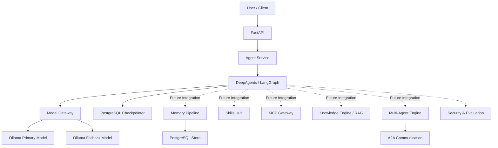

# Hermes Local Workbench (HLW)

> A Local-First, Modular and Extensible AI Agent Workbench  
> 本地优先、模块化、可扩展的智能 Agent 工作台

**Project:** Hermes Local Workbench  
**Abbreviation:** HLW  
**Version:** 0.1.0-dev  
**Development Status:** Active Development  
**Primary Language:** Python  
**Core Framework:** DeepAgents + LangGraph  
**Local Model Runtime:** Ollama

---

## 1. 项目定位与总体目标（Project Vision）

Hermes Local Workbench（HLW）是一个面向个人及本地化部署场景的模块化 AI Agent 工作台。

项目以 DeepAgents 和 LangGraph 为核心框架，以 Ollama 作为本地模型运行环境，通过统一模型网关、长期记忆、Skills、MCP、RAG、多 Agent 协作和安全执行等模块，逐步构建一个具备持续记忆、自主任务处理、工具调用、知识管理和多 Agent 协作能力的本地智能体系统。

HLW 不仅仅是一个能够进行问答的聊天机器人，而是一个能够持续扩展能力、管理任务、调用工具、积累知识并完成复杂工作的本地 AI Agent 基础设施。

### 1.1 核心目标

项目的长期目标包括以下八个方面：

1. **本地化模型运行（Local Model Runtime）**

   以 Ollama 为本地模型运行基础，统一管理主模型、备用模型及不同模型服务，支持模型切换、异常恢复和本地推理。

2. **持续记忆能力（Persistent Memory）**

   建立短期对话状态与长期用户记忆体系，使 Agent 能够跨会话保存、检索和更新用户偏好、项目背景、工作流程及知识信息。

3. **技能扩展体系（Skills Hub）**

   建立统一的 Skills 管理平台，使 Agent 能够根据任务需要发现、加载和执行不同技能，持续扩展自身能力。

4. **外部工具连接（MCP Gateway）**

   通过 Model Context Protocol（MCP）连接外部工具和服务，实现工具发现、注册、调用及统一管理。

5. **知识管理与检索（Knowledge Engine / RAG）**

   建立文档处理、知识提取、向量检索、混合检索和知识引用体系，使 Agent 能够利用个人资料和专业知识完成任务。

6. **多 Agent 协作（Multi-Agent Engine）**

   建立主 Agent 与专业子 Agent 的任务分配、协同执行、结果汇总和通信机制，并逐步探索 Agent-to-Agent（A2A）通信。

7. **安全执行与可靠性（Security & Reliability）**

   建立工具权限管理、人工审批、执行隔离、异常恢复、运行日志及任务追踪机制，降低自主执行带来的安全风险。

8. **评测与持续优化（Evaluation Center）**

   建立模型、记忆、检索、工具调用及复杂任务的评测体系，通过量化指标和自动化测试持续优化系统能力。

### 1.2 最终愿景

HLW 希望逐步形成以下能力：

- 能够理解用户的长期目标和当前任务。
- 能够记住用户明确授权保存的信息。
- 能够根据任务自动选择模型、技能和工具。
- 能够利用本地文件及知识库完成复杂任务。
- 能够调用外部服务和 MCP 工具。
- 能够将复杂任务分配给多个专业 Agent。
- 能够在必要时请求人工审批。
- 能够记录任务执行过程并评价最终结果。
- 能够在本地环境中长期运行和持续扩展。

最终形成一个可持续学习、可扩展、可观察、可控制的个人本地智能工作平台。

---

## 2. 技术架构（System Architecture）

HLW 采用分层、模块化架构，核心执行框架为 DeepAgents + LangGraph。

### 2.1 当前架构



说明：

- 当前 Agent 主链路已经接入模型网关和 PostgreSQL Checkpointer。
- 长期记忆模块已经具备独立实现，但尚未完整接入主 Agent。
- Skills、MCP、RAG、多 Agent 等属于后续扩展方向。

### 2.2 技术栈

| 技术 | 用途 |
|---|---|
| Python 3.11+ | 核心开发语言 |
| DeepAgents | Agent 核心框架 |
| LangGraph | Agent 工作流与状态管理 |
| LangChain | 模型接口及工具生态 |
| Ollama | 本地大模型运行 |
| Qwen3 | 当前主模型与备用模型 |
| PostgreSQL | 对话状态与长期记忆持久化 |
| psycopg | PostgreSQL 异步数据库连接 |
| FastAPI | HTTP API 服务 |
| Pydantic | 数据结构与输入校验 |
| Docker | 应用容器化 |
| Docker Compose | 多服务编排 |
| uv | Python 环境及依赖管理 |
| pytest | 自动化测试 |
| Ruff | 代码质量检查 |
| LangGraph Studio | Agent 工作流可视化与调试 |

---

## 3. 当前开发进度（Current Development Status）

截至 2026-11-04，HLW 已经完成第一阶段核心工程基础的主要建设，正在从基础 Agent 运行框架向完整的模块化 Agent 系统过渡。

### 3.1 已实现的核心模块

#### 3.1.1 项目基础结构（Project Foundation）

已完成：

- Python 项目基础结构。
- `pyproject.toml` 项目依赖管理。
- 环境变量与配置管理。
- 统一日志系统。
- 请求上下文管理。
- 基础模块划分。
- 基础异常处理机制。

#### 3.1.2 Agent 核心引擎（Agent Core）

已完成：

- 基于 DeepAgents 创建主 Agent。
- 基于 LangGraph 构建 Agent 执行图。
- 统一 Agent Graph 入口。
- Agent 异步执行服务。
- 请求 ID 与 Thread ID 管理。
- Agent 并发执行限制。
- 相同 Thread ID 的进程内串行执行控制。
- PostgreSQL 持久化 Agent Runtime。

核心文件：

- `src/hlw/agent/graph.py`
- `src/hlw/agent/service.py`
- `src/hlw/agent/persistent_runtime.py`

#### 3.1.3 模型网关（Model Gateway）

已完成：

- 统一模型注册和客户端创建。
- 主模型与备用模型配置。
- 基于 OpenAI 兼容接口连接 Ollama。
- 模型超时配置。
- 主备模型隔离配置。

当前默认模型配置：

| 模型角色 | 模型 |
|---|---|
| Primary | qwen3:8b |
| Fallback | qwen3:14b |

模型通过统一 Gateway 创建，避免业务模块直接依赖具体模型客户端。

核心文件：

- `src/hlw/models/gateway.py`

#### 3.1.4 模型可靠性与故障恢复（Resilience）

已完成：

- 模型错误分类。
- 网络连接错误识别。
- 超时错误识别。
- HTTP 429 限流识别。
- HTTP 5xx 服务端错误识别。
- 有限次数重试。
- 指数退避。
- 主模型失败后自动切换备用模型。
- 模型调用结果遥测记录。
- JSON 格式模型调用日志。

当前 Agent 主图配置为最多重试 2 次，重试耗尽后调用备用模型。

核心文件：

- `src/hlw/models/errors.py`
- `src/hlw/models/resilience.py`
- `src/hlw/models/telemetry.py`

#### 3.1.5 PostgreSQL 对话持久化（Checkpoint Persistence）

已完成：

- PostgreSQL Checkpointer 连接管理。
- 异步数据库生命周期管理。
- LangGraph Checkpointer 初始化。
- 按 Thread ID 保存对话状态。
- 不同 Thread ID 的状态隔离。
- 服务重新连接后恢复历史对话。
- 持久化 Agent Runtime。

核心文件：

- `src/hlw/memory/checkpoints_postgres.py`
- `src/hlw/agent/persistent_runtime.py`

#### 3.1.6 长期记忆模块（Memory System）

已完成独立模块的主要代码实现：

**MemoryExtractor**
- 使用 LLM 结构化提取候选记忆。
- 支持 preference、project、workflow、fact 四种类别。
- 检查候选记忆的原文证据。
- 过滤重复 key。

**MemoryValidator**
- 检查记忆证据。
- 检查部分常见敏感凭证格式。
- 过滤重复候选记忆。

**MemoryDeduplicator**
- 检查已有记忆。
- 识别重复内容。
- 检测新旧记忆冲突。
- 未经明确授权不覆盖旧记忆。
- 支持明确授权后的记忆更新。

**MemoryManager**
- 保存记忆。
- 读取记忆。
- 按类别检索记忆。
- 更新记忆。
- 删除记忆。
- 按用户 ID 构建独立命名空间。

**MemoryPipeline**
- 协调 Extractor、Validator 和 Deduplicator。
- 统一处理候选记忆。
- 支持用户明确授权后的记忆更新。

**PostgreSQL Store**
- 已实现异步 PostgreSQL Store 适配器。
- 支持长期记忆的持久化管理。

核心文件：

- `src/hlw/memory/extractor.py`
- `src/hlw/memory/validator.py`
- `src/hlw/memory/deduplicator.py`
- `src/hlw/memory/manager.py`
- `src/hlw/memory/pipeline.py`
- `src/hlw/memory/store_postgres.py`
- `src/hlw/memory/schemas.py`

**当前限制：**

长期记忆模块目前主要以独立组件形式存在，尚未完整接入主 Agent 请求链路。

目前主 Agent 尚未实现自动检索长期记忆、跨会话上下文注入和完整的记忆确认交互。因此，记忆模块的代码实现不等于已经具备完整的 Agent 长期记忆能力。

#### 3.1.7 FastAPI 服务（API Layer）

已实现基础 HTTP API：

- `GET /health`：应用存活检查。
- `POST /chat`：提交 Agent 对话请求。
- 自动生成 Request ID。
- 自动生成 Thread ID。
- 常驻 AgentService 生命周期管理。
- 接入 PostgreSQL 持久化运行时。

核心文件：

- `src/hlw/api/app.py`
- `scripts/run_api.py`

当前限制：

- 尚未建立完整的用户身份认证。
- 尚未贯通 API 用户身份与长期记忆 user_id。
- 尚未实现完整的会话所有权控制。
- 尚未形成完整的 Web UI。

#### 3.1.8 Docker 部署基础（Deployment Foundation）

已实现：

- Dockerfile。
- Docker Compose 编排。
- PostgreSQL 16 容器配置。
- FastAPI 应用容器配置。
- PostgreSQL 健康检查。
- API 健康检查。
- 数据卷持久化。
- Ollama 宿主机连接配置。
- 本机回环地址端口绑定。

相关文件：

- `Dockerfile`
- `compose.yaml`

当前配置采用单 Worker 运行方式。由于并发锁目前属于进程内锁，多 Worker 和多实例部署前仍需完善跨进程协调机制。

#### 3.1.9 LangGraph 开发与可视化

已建立 `langgraph.json`，包含：

- `hlw_core` 主 Agent Graph。
- `hlw_fallback_probe` 模型回退测试图。
- PostgreSQL Checkpointer 配置。

后续开发默认采用：

- `langgraph dev`
- LangGraph Studio
- Graph 可视化调试
- Graph 配置与源码同步管理

---

### 3.2 测试与验证进度（Testing & Verification）

仓库已建立单元测试及 PostgreSQL 集成测试脚本。

当前覆盖的测试方向包括：

- Agent Graph 创建。
- Agent Service 请求上下文。
- Agent 并发控制。
- Thread ID 串行执行。
- 模型错误分类。
- 模型重试与回退。
- MemoryExtractor。
- MemoryValidator。
- MemoryManager。
- MemoryDeduplicator。
- MemoryPipeline。
- Memory 并发锁。
- PostgreSQL Store。
- PostgreSQL Checkpointer。
- 跨服务生命周期的对话恢复。

仓库中的项目状态工具记录了最近一次报告为 38 项测试通过、Ruff 检查通过，以及若干 PostgreSQL 和模型调用冒烟测试通过。

注意：上述是已有测试记录，并非对当前最新提交重新执行后的验收结论。后续版本发布前应重新运行完整测试及集成验证。

---

## 4. 当前主要问题与待完善事项（Current Gaps）

目前项目已经有较完整的基础模块，但距离最终目标仍有以下差距：

| 问题 | 当前情况 | 后续要求 |
|---|---|---|
| 长期记忆集成 | 已有独立模块 | 接入 Agent 主流程 |
| 用户身份体系 | API 暂无 user_id | 建立认证和用户隔离 |
| 记忆自动检索 | 尚未接入 | 实现跨会话检索与注入 |
| 记忆授权交互 | 有独立更新接口 | 建立完整审批流程 |
| Skills Hub | 尚未实现 | 建立技能注册和执行体系 |
| MCP Gateway | 尚未实现 | 建立外部工具连接体系 |
| RAG | 尚未实现 | 建立知识导入和检索体系 |
| Multi-Agent | 尚未实现 | 建立多 Agent 协作 |
| A2A | 尚未实现 | 建立 Agent 间通信 |
| 安全执行 | 尚未形成完整体系 | 权限、审批和沙箱 |
| Evaluation Center | 尚未实现 | 建立系统评测 |
| Web UI | 尚未实现 | 建立可视化交互界面 |
| 多进程并发 | 当前使用进程内锁 | 支持分布式协调 |

另外，当前 `get_project_status()` 中的静态项目状态尚未完全同步到最新代码，例如部分已经存在的 Memory 和 FastAPI 代码仍被标记为规划功能。后续应统一项目状态管理，避免 Agent 根据过时信息报告开发进度。

---

## 5. 未来开发路线图（Development Roadmap）

后续开发遵循先完善基础设施、再扩展能力模块、最后形成完整工作平台的原则。

### P0：核心工程基础完善（Foundation Hardening）

**目标：让现有代码形成稳定、可维护、可重复验证的基础系统。**

主要任务：

- 完善项目结构与模块边界。
- 统一项目状态管理。
- 同步 `get_project_status()` 与真实代码。
- 完善模型网关和故障恢复。
- 完善 PostgreSQL 持久化。
- 完善 API 生命周期和错误处理。
- 补齐核心模块集成测试。
- 完善 Docker 部署与运行验证。
- 完善日志、异常和请求追踪。
- 维护 LangGraph Studio 开发配置。

验收标准：

- Agent 能够稳定调用本地模型。
- 主模型失败时能够自动切换备用模型。
- 对话可以跨服务生命周期恢复。
- API 能够稳定提供 Agent 服务。
- 核心测试能够重复通过。

### P1：长期记忆系统完整集成（Persistent Memory Integration）

**目标：使 Agent 真正具备跨会话的持续记忆能力。**

主要任务：

1. 建立用户身份与 user_id 体系。
2. 实现用户和会话的访问权限校验。
3. 将 MemoryPipeline 接入 Agent 请求生命周期。
4. 实现候选记忆自动提取。
5. 实现记忆证据校验和敏感信息过滤。
6. 实现记忆新增、重复识别和冲突检测。
7. 实现明确授权后的记忆更新。
8. 实现 PostgreSQL 长期记忆保存。
9. 实现 Agent 调用前的长期记忆检索。
10. 将相关记忆注入 Agent 上下文。
11. 支持不同 Thread ID 之间共享同一用户的长期记忆。
12. 建立记忆删除、更新和审计机制。

验收标准：

- 用户在一个会话中表达的长期偏好，可以在另一个会话中被正确检索。
- 不同用户的记忆严格隔离。
- 未经授权不得覆盖已有记忆。
- 记忆提取错误不能直接污染长期记忆。
- 记忆模块能够在 PostgreSQL 中长期保存并恢复。

### P2：Skills Hub（技能管理平台）

**目标：让 Agent 能够根据任务动态扩展和使用技能。**

主要任务：

- 设计统一 Skill 规范。
- 建立 Skill 注册中心。
- 支持 Skill 自动发现。
- 支持 Skill 加载和卸载。
- 支持 Skill 版本管理。
- 支持 Skill 元数据与说明文件。
- 支持 Skill 调用和执行结果验证。
- 建立 Skill 权限管理。
- 建立 Skill 执行日志。
- 支持用户自定义技能。

预期能力：

Agent 能够识别任务需要的技能，并根据权限和任务要求选择合适的 Skill，而不是将所有能力写死在主 Agent 中。

### P3：MCP Gateway（外部工具连接）

**目标：建立统一的外部工具接入和管理体系。**

主要任务：

- MCP Server 注册与管理。
- MCP Client 生命周期管理。
- 工具自动发现。
- 工具名称和参数规范化。
- 工具调用与结果返回。
- 连接超时和异常恢复。
- 工具访问权限管理。
- 工具白名单。
- 工具调用日志。
- 与 Skills Hub 和主 Agent 集成。

预期能力：

Agent 能够通过统一 MCP Gateway 使用外部工具，而不需要为每一个外部服务单独编写底层连接逻辑。

### P4：Knowledge Engine / RAG（知识管理系统）

**目标：让 Agent 能够利用本地文档和专业知识完成复杂任务。**

主要任务：

- 文档上传和导入。
- PDF、Word、Markdown 等格式解析。
- 文档切分。
- Embedding 模型接入。
- 向量数据库。
- 向量检索。
- 关键词检索。
- 混合检索。
- Reranker 重排序。
- 知识引用与来源追踪。
- 用户级和项目级知识隔离。
- 知识更新与删除。

预期能力：

用户能够将自己的项目资料、技术文档、论文、代码说明等纳入知识库，Agent 可以根据问题检索相关内容并提供可追溯的回答。

### P5：Multi-Agent Engine（多 Agent 协作引擎）

**目标：从单 Agent 执行模式升级为多 Agent 协作模式。**

主要任务：

- 主 Agent 与子 Agent 架构。
- 专业 Agent 注册和管理。
- 子 Agent 角色定义。
- 复杂任务拆分。
- 任务分配。
- Agent 间消息传递。
- 共享任务状态。
- 子任务结果汇总。
- 失败重试与任务恢复。
- Agent 执行追踪。
- Agent-to-Agent（A2A）通信机制。

预期能力：

用户提交一个复杂任务后，主 Agent 能够将任务拆分并分配给不同专业 Agent，最后整合结果。

例如：

- Research Agent：资料搜索与研究。
- Coding Agent：代码编写与调试。
- Data Agent：数据分析。
- Document Agent：文档生成。
- Review Agent：质量检查。

### P6：安全执行体系（Security & Controlled Execution）

**目标：保证 Agent 在具有自主执行能力的同时，仍然受到明确的权限约束。**

主要任务：

- 用户身份认证。
- 工具权限分级。
- 文件系统访问控制。
- 网络访问控制。
- 敏感信息保护。
- 人工审批机制。
- 危险操作二次确认。
- 安全执行沙箱。
- 命令执行隔离。
- 操作审计。
- 异常行为检测。

基本原则：

Agent 可以提出执行操作，但涉及敏感数据、重要文件、外部系统写入或高风险命令时，应根据权限策略要求审批或拒绝执行。

### P7：Evaluation Center（评测与优化中心）

**目标：建立可量化、可重复的 Agent 质量评估体系。**

主要任务：

- 模型回答质量评测。
- 工具调用成功率评测。
- 任务完成率评测。
- 记忆准确率评测。
- 记忆检索质量评测。
- RAG 检索质量评测。
- 多 Agent 协作效果评测。
- 模型回退成功率统计。
- 请求延迟统计。
- 资源消耗统计。
- 自动化回归测试。
- 测试数据集管理。

重点指标包括：

| 指标 | 评估目的 |
|---|---|
| Task Success Rate | 任务完成率 |
| Tool Success Rate | 工具调用成功率 |
| Memory Accuracy | 记忆准确性 |
| Retrieval Precision | 检索精确率 |
| Retrieval Recall | 检索召回率 |
| Fallback Success Rate | 模型回退成功率 |
| Latency | 响应延迟 |
| Error Rate | 系统错误率 |

### P8：完整 API、Web UI 与部署（Productization）

**目标：形成完整、可长期运行的本地 AI Agent 工作平台。**

主要任务：

- 完善 FastAPI 服务。
- 增加身份认证。
- 支持流式输出。
- 建立任务管理接口。
- 建立会话管理接口。
- 建立记忆管理接口。
- 建立 Skills 管理接口。
- 建立 MCP 管理接口。
- 开发 Web UI。
- 支持任务执行过程可视化。
- 支持多 Agent 工作流可视化。
- 支持运行日志查看。
- 完善 Docker Compose。
- 建立数据库备份和恢复机制。
- 完善部署与升级流程。

最终形成一个可以通过浏览器访问、能够管理任务、技能、记忆、知识库和多个 Agent 的本地智能工作平台。

---

## 6. 核心开发原则（Engineering Principles）

整个 HLW 项目遵循以下原则：

### 6.1 Local-First

优先使用本地模型、本地数据和本地数据库，减少对外部云端模型服务的依赖。

### 6.2 Modular Architecture

每项能力应当具有清晰的模块边界，通过接口和依赖注入进行组合，避免形成庞大的单体 Agent。

### 6.3 Persistent by Design

重要对话状态、长期记忆、任务状态和执行结果应当具备明确的持久化策略。

### 6.4 Security by Design

安全控制应当贯穿模型、记忆、文件、工具和 Agent 执行过程，而不是在系统完成后再补充。

### 6.5 Observable and Testable

每个核心模块都应当具备日志、异常处理和自动化测试，避免仅凭一次成功运行判断功能已经完成。

### 6.6 Evidence-Based Development

严格区分：

- **Implemented：** 已有代码实现。
- **Verified：** 已通过对应测试或运行验收。
- **In Progress：** 已开始开发，但集成或验收尚未完成。
- **Planned：** 尚未开始实现。

代码存在不等于功能完整，单元测试通过也不等于生产环境验收通过。

### 6.7 Human-in-the-Loop

对于重要记忆更新、敏感数据操作和高风险工具调用，应保留必要的人工确认机制。

---

## 7. 项目当前阶段总结（Current Milestone）

当前 HLW 已经具备：

- DeepAgents + LangGraph 主 Agent 基础。
- Ollama 本地模型网关。
- 主模型与备用模型机制。
- 模型重试、故障分类和遥测。
- Agent 异步服务和并发控制。
- PostgreSQL 对话状态持久化。
- 独立长期记忆管理与处理模块。
- FastAPI 基础服务。
- Docker 和 Docker Compose 部署配置。
- LangGraph Studio 开发配置。
- 核心单元测试及 PostgreSQL 集成测试脚本。

目前最重要的工作不是继续堆积功能，而是将已经实现的模块连接起来，建立完整的运行闭环。

**下一阶段首要任务：完成用户身份体系，并将长期记忆模块真正集成到主 Agent，实现跨会话记忆检索、上下文注入和授权更新。**

在此基础上，依次建设 Skills Hub、MCP Gateway、Knowledge Engine、Multi-Agent Engine、安全执行体系和 Evaluation Center。

HLW 的最终目标是：

**构建一个以本地模型为基础、以长期记忆为核心、以 Skills 和 MCP 为扩展能力、以 RAG 和 Multi-Agent 为高级执行能力、以安全与评测为保障的完整个人 AI Agent 工作平台。**

---

## 8. Repository Structure

```text
HLW/
│
├── src/
│   └── hlw/
│       ├── agent/
│       │   ├── graph.py
│       │   ├── service.py
│       │   └── persistent_runtime.py
│       │
│       ├── api/
│       │   └── app.py
│       │
│       ├── core/
│       │   ├── config.py
│       │   ├── concurrency.py
│       │   ├── thread_locks.py
│       │   └── request_context.py
│       │
│       ├── memory/
│       │   ├── checkpoints_postgres.py
│       │   ├── store_postgres.py
│       │   ├── extractor.py
│       │   ├── validator.py
│       │   ├── deduplicator.py
│       │   ├── manager.py
│       │   ├── pipeline.py
│       │   └── schemas.py
│       │
│       ├── models/
│       │   ├── gateway.py
│       │   ├── errors.py
│       │   ├── resilience.py
│       │   └── telemetry.py
│       │
│       └── tools/
│           └── project_tools.py
│
├── tests/
│   └── unit/
│
├── scripts/
│
├── Dockerfile
├── compose.yaml
├── langgraph.json
├── pyproject.toml
├── uv.lock
└── README.md
```

---

**Project:** Hermes Local Workbench (HLW)  
**Repository:** https://github.com/zdx1216/HLW  
**Development Approach:** Incremental Development + Modular Architecture + Continuous Testing  
**Status:** Active Development